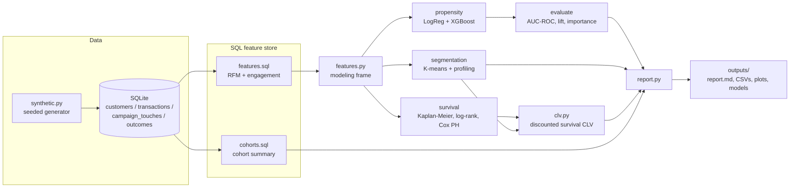

# CohortCraft

Customer propensity and segmentation modeling with Python, scikit-learn, XGBoost, pandas,
SQL and K-means.

CohortCraft is a reproducible pipeline for the standard set of customer analytics questions:

- **Who will convert?** Propensity models (logistic regression, XGBoost) predict customer
  conversion. They are evaluated on a held-out set with AUC-ROC, cross-validated AUC, PR-AUC,
  Brier score and a decile lift table.
- **What kinds of customers do we have?** K-means clustering on behavioural RFM and engagement
  features picks k by silhouette score (elbow inertia is reported too) and gives each segment
  a readable name such as *Champions*, *At Risk* or *Big Spenders*.
- **How long do they stay, and what are they worth?** Kaplan-Meier retention curves and
  log-rank tests compare marketing cohorts and channels. A Cox proportional-hazards model then
  drives a survival-based customer lifetime value (CLV) estimate for every customer, cohort and
  segment.

A seeded synthetic data generator produces customers, transactions, campaign touches,
conversion labels and churn times with a known latent structure, so the whole pipeline runs
without any external data or credentials.

## Architecture



| Module | Responsibility |
| --- | --- |
| `cohortcraft/data/synthetic.py` | Seeded generator; a latent engagement score drives spend, churn, campaign response and conversion |
| `cohortcraft/data/db.py`, `sql/*.sql` | SQLite schema, loading, and SQL feature and cohort queries |
| `cohortcraft/features.py` | Feature matrix and modeling frame (features + labels) |
| `cohortcraft/propensity/` | Model registry, stratified CV training, evaluation, scoring |
| `cohortcraft/segmentation/` | Log + scale + K-means pipeline, k search, segment profiles and names |
| `cohortcraft/survival/` | KM curves, log-rank tests, Cox PH, per-customer and per-cohort CLV |
| `cohortcraft/pipeline.py`, `cli.py`, `report.py` | End-to-end orchestration, CLI, Markdown report |

### CLV method

For an active customer *i* with current tenure *T*:

```
CLV_i = realised_margin_i + Σ_{t=1..H} m_i · S_i(T+t)/S_i(T) · (1+d)^-t
```

Here `m_i` is monthly margin (purchase rate × average order value × gross margin), `S_i` is the
Cox survival curve conditioned on survival to date, `d` is the monthly discount rate and `H`
is the horizon. Churned customers have zero residual value. Cohort-level expected CLV for a new
customer applies the same discounting to each cohort's Kaplan-Meier curve.

## How to run

Requires Python 3.10+. No GPU, external data or credentials are needed.

```bash
python -m venv .venv && source .venv/bin/activate
pip install -e ".[dev]"          # or: pip install -r requirements.txt
cp .env.example .env             # optional: tweak seed, size, snapshot, CLV settings

# Generate synthetic data into outputs/cohortcraft.db
cohortcraft generate --customers 5000

# Run the full pipeline (add --regenerate to rebuild the database first)
cohortcraft -v run

# Score customers with a saved model
cohortcraft score --model outputs/models/xgboost.joblib --out scores.csv
```

`python -m cohortcraft ...` works the same way as the `cohortcraft` command.

Outputs written to `outputs/`:

- `report.md`: full run summary (metrics, lift, segments, hazard ratios, CLV)
- `propensity_metrics.csv`, `lift_table.csv`, `segment_profiles.csv`, `cohort_clv.csv`, `cox_summary.csv`
- `customer_scores.csv`: one row per customer with features, propensity, decile, segment and CLV
- `roc_curve.png`, `segments.png`, `km_by_channel.png`, `km_by_segment.png`
- `models/*.joblib`: fitted propensity pipelines

### Using your own data

Load your extracts into SQLite with the same columns as `sql/schema.sql` (customers,
transactions, campaign_touches, outcomes), point `COHORTCRAFT_DB_PATH` at the file, set
`COHORTCRAFT_SNAPSHOT_DATE`, and run `cohortcraft run` without `--regenerate`.

## How to test

```bash
pip install -e ".[dev]"
pytest -q
```

The tests run on a small in-memory synthetic dataset of 800 customers. They cover:

- generator determinism and referential integrity
- SQL feature correctness (frequency counts, rate bounds, cohort summary)
- propensity models beating random (AUC > 0.65), lift table and scoring
- segmentation k search, profiling and stable assignment
- survival monotonicity, Cox direction of effects, CLV discounting and censoring rules
